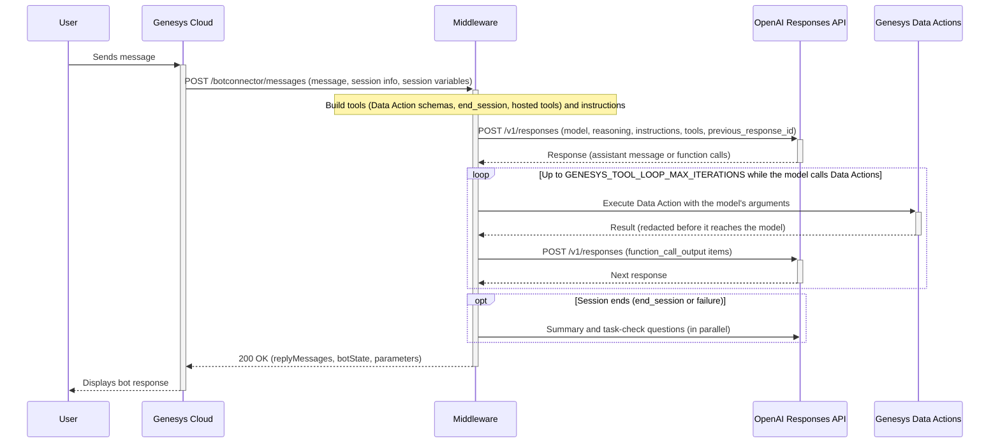

# Genesys Cloud Digital Bot Connector & OpenAI Responses API Middleware

## 1. Overview

This document outlines a middleware service connecting the Genesys Cloud Digital Bot Connector (v2) with the OpenAI Responses API. It creates a secure, scalable bridge for Genesys Cloud Architect flows to use OpenAI's generative models for conversational AI, handling session management, message transformation, tool calling, security, and configuration.

More info about Genesys Cloud Digital Bot Connector: https://help.mypurecloud.com/articles/about-genesys-digital-bot-connector

More info about OpenAI Responses API: https://developers.openai.com/api/reference/resources/responses/methods/create

### Key Features

* **Latest OpenAI models only**: The connector exposes exactly two models, GPT-6.1 Terra and GPT-6 Luna (see [Supported Models](#3-supported-models)). Requests for any other model are ignored and fall back to a supported one.
* **Stateless Conversation Management**: Uses OpenAI's `previous_response_id` mapped to Genesys's `botSessionId` for context, avoiding the need to store chat history.
* **Dynamic Configuration**: Leverages Genesys Session Variables to set the system prompt, model, reasoning effort, temperature, and response verbosity per interaction.
* **Genesys Data Actions as OpenAI Tools**: Exposes the Genesys Cloud Data Actions listed in the `data_action_ids` session variable as OpenAI function tools. The middleware fetches their JSON schemas, runs the actions the model asks for, and returns the results to the model in a bounded function-calling loop.
* **Session Ending and Outcome Reporting**: The model can end the conversation with the built-in `end_session` tool. When a session ends, the middleware returns a conversation summary and whether the task was accomplished as output session variables.
* **Hosted Tool Integration**: Supports OpenAI's hosted tools, such as remote MCP servers and web search, through a JSON configuration file. This feature has not been tested against a live MCP server yet, and it is here to illustrate potential advanced use cases.

## 2. Architecture

The middleware acts as a translation layer between the Genesys Cloud and OpenAI APIs, and runs Genesys Data Actions on behalf of the model.



## 3. Supported Models

Each model is published to Genesys Architect as a "bot", and the bot ID is the OpenAI model ID. These are the only models the middleware sends to OpenAI.

| Bot ID / Model | Best for | Notes |
|---|---|---|
| `gpt-6.1-terra` | Clear, natural writing and visual reasoning. A good fit for most customer conversations. | Default model. |
| `gpt-6-luna` | Focused, high-volume tasks at the lowest cost. | |

Both models have a 1,050,000-token context window and up to 128,000 output tokens, and both accept every reasoning effort from `none` to `max`. See the OpenAI model pages for [GPT-6.1 Terra](https://developers.openai.com/api/docs/models/gpt-6.1-terra) and [GPT-6 Luna](https://developers.openai.com/api/docs/models/gpt-6-luna) for pricing and rate limits.

**Upgrading from an earlier version:** the former bots (`gpt-5-mini`, `gpt-5-nano`, `gpt-4.1-mini`, and `gpt-4.1-nano`) no longer exist. Architect keeps the bot list from the time a flow was published, so open each **Call Digital Bot Connector** action, select one of the bots above, and republish the flow. Until then, requests from those flows are served by `DEFAULT_OPENAI_MODEL`.

## 4. API Endpoints

The middleware implements the following endpoints to comply with the Genesys Digital Bot Connector specification (https://developer.genesys.cloud/commdigital/textbots/digital-botconnector-customer-api-spec).

### GET /botconnector/bots

Provides Genesys Architect with the list of available "bots", one per supported model.

### GET /botconnector/bots/{botId}

Returns details for a specific bot configuration by its ID.

### POST /botconnector/messages

The core endpoint for processing messages. It receives messages from Genesys, forwards them to OpenAI, runs any Data Actions the model calls, and returns the response.

## 5. Request & Response Mapping

### Genesys to OpenAI Request Transformation

The middleware maps the Genesys `IncomingMessagesRequest` to an OpenAI `POST /v1/responses` request. Key transformations include:

| Genesys Field | OpenAI Field | Logic / Notes |
|---|---|---|
| `botSessionId` | `previous_response_id` | Looks up the last response ID stored for the session to maintain conversation context. |
| `inputMessage.text` | `input` | The user's message. |
| `botId` or `parameters.openai_model` | `model` | Only `gpt-6.1-terra` and `gpt-6-luna` are accepted. |
| `parameters.system_prompt` | `instructions` | Combined with guidance about the available Data Action tools. Sent on every call because instructions are not carried over by `previous_response_id`. |
| `parameters.data_action_ids` | `tools` | One function tool per Data Action, plus the built-in `end_session` tool and any hosted tools from the tools config file. `parallel_tool_calls` is `false`, so actions run one at a time. |
| `parameters.openai_reasoning_effort` | `reasoning.effort` | Defaults to `DEFAULT_OPENAI_REASONING_EFFORT`. |
| `parameters.openai_temperature` | `temperature` | Sent only when the reasoning effort is `none`. |
| `parameters.openai_verbosity` | `text.verbosity` | Sent only when configured. |
| `genesysConversationId` | `metadata` | Maps to `{ "genesys_conversation_id": "<value>" }`. |
| (configured prefix) | `prompt_cache_key` | `<PROMPT_CACHE_KEY_PREFIX>:<model>`, sent only when `PROMPT_CACHE_KEY_PREFIX` is set. |
| (always) | `store: true` | Required for `previous_response_id` chaining. |

Session variables are stored with the session, so values sent on the first turn keep applying to later turns unless Genesys sends a new value.

### Function Calling Flow (Genesys Data Actions)

1. The Architect flow sets `data_action_ids` to a pipe-separated (`|`) list of Data Action IDs, and optionally `data_action_descriptions` with one description per ID in the same order.
2. The middleware fetches each action's input and success schemas (cached in the session store) and builds one function tool per action. Actions whose schemas cannot be fetched are skipped.
3. When the model returns function calls, the middleware runs the matching Data Action through the Genesys `POST /api/v2/integrations/actions/{actionId}/test` endpoint, with timeouts and retries. It removes the fields listed in `TOOL_OUTPUT_REDACTION_FIELDS` from the result and sends it back to the model as a `function_call_output`.
4. The loop repeats until the model answers without calling tools, or until `GENESYS_TOOL_LOOP_MAX_ITERATIONS` is reached. Hitting the limit ends the session with `botState: Failed` and the error code `tool_loop_exceeded`.

### Ending the Session

The model can call the built-in `end_session` tool when the user is done, asks for a human agent, is very frustrated, or abuses the service. The middleware then returns `botState: Complete` with the tool's closing message, so the Architect flow continues on its success path.

Whenever a session ends with `Complete` or `Failed`, the middleware asks the model two short follow-up questions (in parallel, without reasoning and with temperature 0) and returns the answers as output session variables:

* `summary_out` (String): A summary of the conversation in less than 300 characters. Omitted if it cannot be generated.
* `task_achieved` (String): `"true"` or `"false"`, depending on whether the model considers the task in the instructions accomplished. Only returned when instructions (`system_prompt` or Data Action tools) are in use.

### OpenAI to Genesys Response Transformation

| OpenAI Field | Genesys Field | Logic / Notes |
|---|---|---|
| `id` | `botSessionId` mapping | Stores the `response.id` for the next turn, but only after a successful turn, so a failed turn never breaks the conversation chain. |
| `output[]` messages | `replyMessages` | Each assistant message becomes one `Text` reply. Messages in the `commentary` phase (progress notes written while the model uses tools) are skipped when a final answer exists. Refusals are returned as text. |
| `status` | `botState` | `completed` maps to `MoreData`. `incomplete` maps to `MoreData` with the partial text when the reason is `max_output_tokens`, and to `Failed` otherwise. `failed` and any other status map to `Failed`. An `end_session` call maps to `Complete`. |
| `error` / `incomplete_details` | `errorInfo` | Maps error details to the `ErrorInfo` object. |

### Error Handling

The middleware follows the Genesys rules for webhook errors: Genesys retries `5xx` responses and sends the flow down the failure path for everything else.

| Situation | HTTP status | `botState` |
|---|---|---|
| OpenAI timeout, connection error, rate limit (429), or OpenAI 5xx | `500` (Genesys retries) | `Failed` |
| The same errors after a Data Action already ran in this turn | `200`, so the retry does not run the action twice | `Failed` |
| Other OpenAI errors, such as an invalid API key or a bad request | `200` | `Failed` |
| Missing or invalid `GENESYS_CONNECTION_SECRET` | `403` | n/a |
| No OpenAI API key configured, or invalid JSON body | `400` | n/a |

A failed Data Action does not fail the turn: the error is passed to the model, which can explain it to the user or try again.

## 6. Configuration

The middleware's behavior is controlled through environment variables, which can be loaded from a `.env.local` file during local development or set directly in the Vercel project settings for production. This approach ensures that sensitive information is kept out of the codebase. The committed [`.env.example`](.env.example) lists every variable with placeholder values.

### Core Settings

| Variable | Description | Example |
|---|---|---|
| `PORT` | The port the service will run on for local development. | `3000` |
| `LOG_LEVEL` | Sets the logging verbosity. Options are `debug`, `info`, `warn`, or `error`. | `info` |
| `GENESYS_CONNECTION_SECRET` | **Required.** A strong, unique secret used to validate that incoming requests are from your Genesys Cloud organization. If it is not set, every request is rejected. | `your-secure-secret-string` |
| `OPENAI_API_KEY` | Your OpenAI API key. When it is not set, the middleware uses the `OPENAI_API_KEY` credential sent by the Genesys integration instead (see [API Key Handling](#api-key-handling)). | `sk-...` |
| `DEFAULT_OPENAI_MODEL` | The model used when the Genesys bot ID is not a supported model. Must be `gpt-6.1-terra` or `gpt-6-luna`. | `gpt-6.1-terra` |
| `DEFAULT_OPENAI_REASONING_EFFORT` | The default reasoning effort: `none`, `low`, `medium`, `high`, `xhigh`, or `max`. Defaults to `low`, which helps the model decide when to call tools while keeping replies fast. | `low` |
| `DEFAULT_OPENAI_TEMPERATURE` | The default creativity/randomness setting (0.0 to 2.0). Lower values are more deterministic. Only sent when the reasoning effort is `none`. | `0.7` |
| `DEFAULT_OPENAI_VERBOSITY` | Optional default response length: `low`, `medium`, or `high`. When unset, OpenAI's default (`medium`) applies. | `low` |
| `OPENAI_TIMEOUT_MS` | Timeout for each OpenAI request, in milliseconds. Defaults to `25000`. See [Reasoning Effort, Temperature and Latency](#reasoning-effort-temperature-and-latency). | `25000` |
| `PROMPT_CACHE_KEY_PREFIX` | Optional prefix for the OpenAI `prompt_cache_key`, which improves prompt cache hits for requests that share the same instructions. | `genesys-bot` |
| `MCP_SERVERS_CONFIG_PATH` | An optional path to a JSON file that defines external MCP servers or other hosted OpenAI tools to enable. | `./mcp_config.json` |
| `SESSION_STORE_TYPE` | Specifies the session storage mechanism. Use `memory` for local testing and `redis` for production/serverless environments. | `redis` |
| `KV_REST_API_URL` | The REST API URL for your Redis database (e.g., from Vercel KV or Upstash). Required if `SESSION_STORE_TYPE` is `redis`. | `https://your-db.upstash.io` |
| `KV_REST_API_TOKEN` | The read/write token for your Redis database. Required if `SESSION_STORE_TYPE` is `redis`. | `your-upstash-token` |

### Genesys Data Action Settings

| Variable | Description | Default |
|---|---|---|
| `ENABLE_GENESYS_FUNCTION_TOOLS` | Feature flag for exposing Genesys Data Actions as OpenAI tools. | `true` |
| `GENESYS_CLIENT_ID` | Client ID of a Genesys Cloud OAuth client (Client Credentials grant) used to fetch schemas and run Data Actions. | |
| `GENESYS_CLIENT_SECRET` | Secret of that OAuth client. | |
| `GENESYS_REGION` | Genesys region host suffix used to build the API and login URLs, for example `mypurecloud.de` gives `https://api.mypurecloud.de`. | `mypurecloud.com` |
| `GENESYS_BASE_URL` | Optional full API origin. Overrides `GENESYS_REGION`. | |
| `GENESYS_LOGIN_URL` | Optional full login origin. Overrides `GENESYS_REGION`. | |
| `GENESYS_ALLOWED_DATA_ACTION_IDS` | Optional pipe-separated (`|`) allowlist. Only these actions can be exposed. If none of the requested actions are allowed, or none are requested, all allowlisted actions are exposed. | |
| `MAX_GENESYS_TOOLS_PER_TURN` | Maximum number of Data Action tools per turn. | `20` |
| `GENESYS_TOOL_LOOP_MAX_ITERATIONS` | Maximum number of tool-calling rounds per turn. | `3` |
| `GENESYS_MAX_ACTION_CALLS_PER_TURN` | Maximum number of Data Action executions per turn. | `10` |
| `GENESYS_MAX_TOOL_ARGUMENT_BYTES` | Maximum size of the arguments the model sends to a Data Action. Larger calls are rejected. | `16384` |
| `GENESYS_ACTIONS_PER_MINUTE` | Maximum Data Action executions per conversation per minute. The counter lives in the memory of each server instance, so on Vercel it is a best-effort safeguard. | `30` |
| `TOOL_OUTPUT_REDACTION_FIELDS` | Comma-separated dot paths removed from Data Action results before they reach the model, for example `customer.email,customer.phone`. | |
| `GENESYS_TOOLS_STRICT_MODE` | Sends Data Action schemas as strict JSON Schemas (`additionalProperties: false`, every property required). Some permissive schemas fail in strict mode. | `false` |
| `GENESYS_TOKEN_CACHE_TTL_SECONDS` | Maximum time an OAuth token is cached. | `3000` |
| `GENESYS_HTTP_TIMEOUT_MS` | Timeout for Genesys API requests. | `10000` |
| `GENESYS_HTTP_RETRY_MAX` | Maximum retries for Genesys API requests. | `3` |
| `GENESYS_HTTP_RETRY_BACKOFF_MS` | Initial retry backoff (exponential). | `250` |

### Genesys Session Variables

You can control the middleware per interaction by setting Session Variables on the **Call Digital Bot Connector** action. They are passed in the `parameters` object of the request. Invalid values are ignored and logged as warnings.

* `system_prompt` (String): The system-level instructions for the model, such as persona, domain policy, or compliance rules.
* `data_action_ids` (String): Pipe-separated (`|`) list of Genesys Cloud Data Action IDs to expose as tools, for example `custom_-_1111aaaa-...|custom_-_2222bbbb-...`.
* `data_action_descriptions` (String): Pipe-separated (`|`) list of descriptions in the same order as `data_action_ids`. Each description tells the model when to use the action.
* `openai_model` (String): Overrides the model selected by the bot. Use this to switch between `gpt-6.1-terra` and `gpt-6-luna` within the same flow. Any other model is ignored.
* `openai_reasoning_effort` (String): Overrides `DEFAULT_OPENAI_REASONING_EFFORT`. One of `none`, `low`, `medium`, `high`, `xhigh`, or `max`.
* `openai_temperature` (String): Overrides `DEFAULT_OPENAI_TEMPERATURE`. This value must be a string that can be parsed into a number between 0 and 2 (e.g., "0.8"). It is ignored unless the reasoning effort is `none`.
* `openai_verbosity` (String): Overrides `DEFAULT_OPENAI_VERBOSITY`. One of `low`, `medium`, or `high`.

The output session variables `summary_out` and `task_achieved` are described in [Ending the Session](#ending-the-session).

### Reasoning Effort, Temperature and Latency

GPT-6.1 Terra and GPT-6 Luna are reasoning models. The OpenAI API rejects `temperature` (and `top_p`) for these models unless `reasoning.effort` is `none`, so the middleware only sends a temperature in that case.

Genesys waits for a bot reply only as long as the **Bot Response Timeout** set on the Architect action (60 seconds at most). One turn can make several OpenAI calls: the first answer, one more call per tool-calling round, and the summary and task check when the session ends. Each call times out after `OPENAI_TIMEOUT_MS`, and Data Actions add their own time. Keep the defaults (`low` effort, 3 tool rounds, 25-second timeout) unless you have tested response times with realistic conversations. Use `none` for the fastest replies, and raise the effort only for flows that need deeper reasoning.

### Example `mcp_config.json`

This file configures hosted OpenAI tools without code changes. The application reads it on every request, and it is bundled into the Vercel deployment through `outputFileTracingIncludes` in `next.config.mjs`. If you store the file under a different path, update that setting as well.

```json
[
  {
    "type": "mcp",
    "server_label": "deepwiki",
    "server_url": "https://mcp.deepwiki.com/mcp",
    "require_approval": "never"
  },
  {
    "type": "web_search"
  }
]
```

Keep these constraints in mind:

* Entries without a `type` are treated as remote MCP servers (`"type": "mcp"`).
* Set `"require_approval": "never"` on MCP servers. The OpenAI default is `always`, which pauses the response for an approval that this connector cannot give.
* Use hosted tools only (`mcp`, `web_search`, `file_search`, `code_interpreter`). Use Genesys Data Actions for your own functions.
* This file is committed to the repository, so never put API keys or tokens in it, for example in an MCP `headers` or `authorization` field.

## 7. Security

### Connection Secret

On every incoming request to `POST /botconnector/messages`, the middleware validates the `GENESYS_CONNECTION_SECRET` sent in the request headers using a constant-time comparison. If the secret is missing or does not match the value set in the environment variables, the request is rejected with a `403 Forbidden` status, preventing unauthorized access. If the environment variable itself is not set, all requests are rejected.

### API Key Handling

The middleware supports two ways to provide the OpenAI API key:

* **Environment variable (recommended):** set `OPENAI_API_KEY` in the Vercel project settings. It takes precedence over any key sent by Genesys.
* **Genesys credential:** when the environment variable is not set, the middleware uses the `OPENAI_API_KEY` credential of the Genesys integration, which Genesys sends as a request header. This lets each Genesys organization use its own key.

**The key is never logged or stored**, and API keys and bearer tokens are redacted from OpenAI error messages before they are logged or returned to Genesys.

### Genesys OAuth Client and Data Action Results

Give the OAuth client used for Data Actions only the permissions it needs to view and execute those actions (`integrations:action:view` and `integrations:action:execute`). Results are sent to OpenAI, so list any personal or sensitive fields the model does not need in `TOOL_OUTPUT_REDACTION_FIELDS`. The middleware logs Data Action IDs, durations, and failures, never arguments or results (except at the `debug` log level, which also logs the incoming Genesys request).

## 8. Session Management

### The Need for a Persistent State Store (Redis)

HTTP-based APIs are inherently **stateless**, meaning each request is independent and has no memory of previous requests. However, chatbot conversations are **stateful** and require context from previous turns to be coherent. This middleware bridges that gap by managing the conversation state.

The core mechanism is mapping the persistent `botSessionId` provided by Genesys to the `previous_response_id` required by the OpenAI Responses API for multi-turn conversations. The middleware also keeps the session variables and caches the Data Action schemas for the session, so they do not have to be fetched again on every turn.

In a **serverless environment** like Vercel, each API request might be handled by a different, short-lived function instance. A simple in-memory variable would be lost as soon as the function finishes. Therefore, an **external, persistent data store is mandatory** for production.

This is why a **Redis database** (such as Vercel KV or Upstash) is used. It provides a fast, reliable key-value store that persists the session data across countless independent serverless function invocations, enabling a seamless and stateful conversation for the end-user.

### Implementation Details

* **Storage Options**: For local development, the application can use a simple in-memory store. For all production and serverless deployments, a persistent Redis database is required.
* **Key-Value Structure**:
  * **Key**: `session_data:<botSessionId>`
  * **Value**: A JSON object with `previousResponseId`, `sessionVariables`, and `dataActionSchemas` (input and success schemas per Data Action ID).
  * Sessions written by earlier versions under the key `<botSessionId>` are still read.
* **Session Expiration (TTL)**: The middleware uses the `botSessionTimeout` value from the Genesys request to set a Time-to-Live (TTL) on each session entry. This automatically clears stale sessions from the store, preventing data buildup.
* **OpenAI Storage**: Responses are created with `store: true`, which `previous_response_id` requires. OpenAI keeps stored responses for 30 days by default. All earlier turns in a chain are billed as input tokens on every new turn. The summary and task-check questions are not stored.

## 9. Deployment and Setup

### Requirements

* Node.js 22 or later (required by the `openai` SDK v7).
* An OpenAI API key with access to `gpt-6.1-terra` and/or `gpt-6-luna`.
* For Data Actions: a Genesys Cloud OAuth client with the Client Credentials grant.

The project is built with Next.js 16 (App Router route handlers) and the official `openai` Node.js SDK v7.

### Local Development

1. Install dependencies: `npm install`
2. Copy `.env.example` to `.env.local` and fill in your own values.
3. Start the development server: `npm run dev`
4. Run the unit tests: `npm test`
5. Run the linter: `npm run lint`

### Vercel Deployment

This middleware is optimized for deployment on Vercel's serverless platform.

1. **Link Repository**: Connect your GitHub repository to a new Vercel project.
2. **Set Environment Variables**: In the Vercel project dashboard, navigate to **Settings > Environment Variables**. Add all the necessary variables from the configuration tables above, such as `GENESYS_CONNECTION_SECRET`, `OPENAI_API_KEY`, and `SESSION_STORE_TYPE=redis`.
3. **Configure Redis**: Navigate to the **Storage** tab in your Vercel dashboard and create a new **KV (Redis)** database. Connect it to your project, and Vercel will automatically create and link the `KV_REST_API_URL` and `KV_REST_API_TOKEN` environment variables.
4. **Deploy**: Push your code to the main branch to trigger a production deployment. The `engines` field in `package.json` pins the runtime to Node.js 22.x, matching the project's Node.js Version setting. Change both together when you move to a newer Node.js major.

### Genesys Cloud Configuration

In your Genesys Cloud organization, set up the Digital Bot Connector integration:

1. **Bot Connector URI**: Enter the full URL of your deployed Vercel application, pointing to the API base path.
   * **Example**: `https://your-app-name.vercel.app/api/botconnector`
2. **Set Credentials**: Configure `GENESYS_CONNECTION_SECRET` in the integration credentials. Add `OPENAI_API_KEY` as well if the key is not set as an environment variable:


3. Example invocation from Inbound Message Flow:


This screenshot was taken with an earlier version and shows the retired `OpenAI GPT-4.1 mini` bot. Select `OpenAI GPT-6.1 Terra` or `OpenAI GPT-6 Luna` as the **Digital Bot Name** instead. The `openai_temperature` session variable shown only applies while the reasoning effort is `none`.
