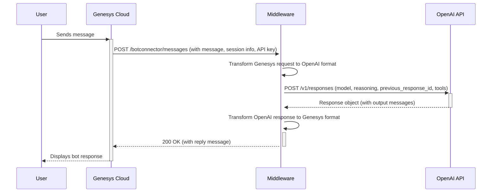

# Genesys Cloud Digital Bot Connector & OpenAI Responses API Middleware

## 1. Overview

This document outlines a middleware service connecting the Genesys Cloud Digital Bot Connector (v2) with the OpenAI Responses API. It creates a secure, scalable bridge for Genesys Cloud Architect flows to use OpenAI's generative models for conversational AI, handling session management, message transformation, security, and configuration.

More info about Genesys Cloud Digital Bot Connector: https://help.mypurecloud.com/articles/about-genesys-digital-bot-connector

More info about OpenAI Responses API: https://developers.openai.com/api/reference/resources/responses/methods/create

### Key Features

* **Latest OpenAI models only**: The connector exposes exactly two models, GPT-6.1 Terra and GPT-6 Luna (see [Supported Models](#3-supported-models)). Requests for any other model are ignored and fall back to a supported one.
* **Stateless Conversation Management**: Uses OpenAI's `previous_response_id` mapped to Genesys's `botSessionId` for context, avoiding the need to store chat history.
* **Dynamic Configuration**: Leverages Genesys Session Variables to control the model, reasoning effort, temperature, and response verbosity per interaction.
* **Tool Integration**: Supports OpenAI's hosted tools, such as remote MCP servers and web search, through a JSON configuration file. Note that this feature has not been tested against a live MCP server yet, and it is here just for illustrating potential advanced use cases.

## 2. Architecture

The middleware acts as a translation layer, following a simple, linear flow between the Genesys Cloud and OpenAI APIs.



## 3. Supported Models

Each model is published to Genesys Architect as a "bot", and the bot ID is the OpenAI model ID. These are the only models the middleware sends to OpenAI.

| Bot ID / Model | Best for | Notes |
|---|---|---|
| `gpt-6.1-terra` | Clear, natural writing and visual reasoning. A good fit for most customer conversations. | Default model. |
| `gpt-6-luna` | Focused, high-volume tasks at the lowest cost. | |

Both models have a 1,050,000-token context window and up to 128,000 output tokens, and both accept every reasoning effort from `none` to `max`. See the OpenAI model pages for [GPT-6.1 Terra](https://developers.openai.com/api/docs/models/gpt-6.1-terra) and [GPT-6 Luna](https://developers.openai.com/api/docs/models/gpt-6-luna) for pricing and rate limits.

**Upgrading from an earlier version:** the former bots `gpt-4.1-mini` and `gpt-4.1-nano` no longer exist. Update each **Call Digital Bot Connector** action in Architect to select one of the bots above and republish the flow. Until then, requests from those flows are served by `DEFAULT_OPENAI_MODEL`.

## 4. API Endpoints

The middleware implements the following endpoints to comply with the Genesys Digital Bot Connector specification (https://developer.genesys.cloud/commdigital/textbots/digital-botconnector-customer-api-spec).

### GET /botconnector/bots

Provides Genesys Architect with the list of available "bots", one per supported model.

### GET /botconnector/bots/{botId}

Returns details for a specific bot configuration by its ID.

### POST /botconnector/messages

The core endpoint for processing messages. It receives messages from Genesys, forwards them to OpenAI, and returns the response.

## 5. Request & Response Mapping

### Genesys to OpenAI Request Transformation

The middleware maps the Genesys `IncomingMessagesRequest` to an OpenAI `POST /v1/responses` request. Key transformations include:

| Genesys Field | OpenAI Field | Logic / Notes |
|---|---|---|
| `botSessionId` | `previous_response_id` | Looks up the last response ID stored for the session to maintain conversation context. |
| Header `OPENAI_API_KEY` | Header `Authorization` | Formats the key as `Bearer <key>`. |
| `inputMessage.text` | `input` (string) | The user's primary message. |
| `botId` or `parameters.openai_model` | `model` | Only `gpt-6.1-terra` and `gpt-6-luna` are accepted. |
| `parameters.openai_reasoning_effort` | `reasoning.effort` | Defaults to `DEFAULT_OPENAI_REASONING_EFFORT`. |
| `parameters.openai_temperature` | `temperature` | Sent only when the reasoning effort is `none`. |
| `parameters.openai_verbosity` | `text.verbosity` | Sent only when configured. |
| `genesysConversationId` | `metadata` | Maps to `{ "genesys_conversation_id": "<value>" }`. |
| Tools config file | `tools` | Loads pre-configured MCP servers and other hosted tools. Omitted when the file is empty or not configured. |
| (always) | `store: true` | Required for `previous_response_id` chaining. |

### OpenAI to Genesys Response Transformation

| OpenAI Field | Genesys Field | Logic / Notes |
|---|---|---|
| `id` | `botSessionId` mapping | Stores the `response.id` for the next turn, but only after a successful turn, so a failed turn never breaks the conversation chain. |
| `output[]` messages | `replyMessages` | Each assistant message becomes one `Text` reply. Messages in the `commentary` phase (progress notes written while the model uses tools) are skipped when a final answer exists. Refusals are returned as text. |
| `status` | `botState` | `completed` maps to `MoreData`. `incomplete` maps to `MoreData` with the partial text when the reason is `max_output_tokens`, and to `Failed` otherwise. `failed` and any other status map to `Failed`. |
| `error` / `incomplete_details` | `errorInfo` | Maps error details to the `ErrorInfo` object. |

### Error Handling

The middleware follows the Genesys rules for webhook errors: Genesys retries `5xx` responses and sends the flow down the failure path for everything else.

| Situation | HTTP status | `botState` |
|---|---|---|
| OpenAI timeout, connection error, rate limit (429), or OpenAI 5xx | `500` (Genesys retries) | `Failed` |
| Other OpenAI errors, such as an invalid API key or a bad request | `200` | `Failed` |
| Missing or invalid `GENESYS_CONNECTION_SECRET` | `403` | n/a |
| Missing `OPENAI_API_KEY` header or invalid JSON body | `400` | n/a |

## 6. Configuration

The middleware's behavior is controlled through environment variables, which can be loaded from a `.env.local` file during local development or set directly in the Vercel project settings for production. This approach ensures that sensitive information is kept out of the codebase. The committed [`.env.example`](.env.example) lists every variable with placeholder values.

| Variable | Description | Example |
|---|---|---|
| `PORT` | The port the service will run on for local development. | `3000` |
| `LOG_LEVEL` | Sets the logging verbosity. Options are `debug`, `info`, `warn`, or `error`. | `info` |
| `GENESYS_CONNECTION_SECRET` | **Required.** A strong, unique secret used to validate that incoming requests are from your Genesys Cloud organization. If it is not set, every request is rejected. | `your-secure-secret-string` |
| `DEFAULT_OPENAI_MODEL` | The model used when the Genesys bot ID is not a supported model. Must be `gpt-6.1-terra` or `gpt-6-luna`. | `gpt-6.1-terra` |
| `DEFAULT_OPENAI_REASONING_EFFORT` | The default reasoning effort: `none`, `low`, `medium`, `high`, `xhigh`, or `max`. Defaults to `none` for the fastest replies. | `none` |
| `DEFAULT_OPENAI_TEMPERATURE` | The default creativity/randomness setting (0.0 to 2.0). Lower values are more deterministic. Only sent when the reasoning effort is `none`. | `0.7` |
| `DEFAULT_OPENAI_VERBOSITY` | Optional default response length: `low`, `medium`, or `high`. When unset, OpenAI's default (`medium`) applies. | `low` |
| `OPENAI_TIMEOUT_MS` | Timeout for each OpenAI request, in milliseconds. Keep it below the **Bot Response Timeout** of the Architect action (60 seconds at most). Defaults to `50000`. | `25000` |
| `MCP_SERVERS_CONFIG_PATH` | An optional path to a JSON file that defines external MCP servers or other OpenAI tools to enable. | `./mcp_config.json` |
| `SESSION_STORE_TYPE` | Specifies the session storage mechanism. Use `memory` for local testing and `redis` for production/serverless environments. | `redis` |
| `KV_REST_API_URL` | The REST API URL for your Redis database (e.g., from Vercel KV or Upstash). Required if `SESSION_STORE_TYPE` is `redis`. | `https://your-db.upstash.io` |
| `KV_REST_API_TOKEN` | The read/write token for your Redis database. Required if `SESSION_STORE_TYPE` is `redis`. | `your-upstash-token` |

### Genesys Session Variables

You can dynamically control the OpenAI model's behavior on a per-interaction basis by setting Session Variables in your Genesys Architect flow. These variables are passed in the `parameters` object of the request. Invalid values are ignored and logged as warnings.

* `openai_model` (String): Overrides the model selected by the bot. Use this to switch between `gpt-6.1-terra` and `gpt-6-luna` for different use cases within the same flow. Any other model is ignored.
* `openai_reasoning_effort` (String): Overrides `DEFAULT_OPENAI_REASONING_EFFORT`. One of `none`, `low`, `medium`, `high`, `xhigh`, or `max`.
* `openai_temperature` (String): Overrides `DEFAULT_OPENAI_TEMPERATURE`. This value must be a string that can be parsed into a number between 0 and 2 (e.g., "0.8"). It is ignored unless the reasoning effort is `none`.
* `openai_verbosity` (String): Overrides `DEFAULT_OPENAI_VERBOSITY`. One of `low`, `medium`, or `high`.

### Reasoning Effort, Temperature and Latency

GPT-6.1 Terra and GPT-6 Luna are reasoning models. The OpenAI API rejects `temperature` (and `top_p`) for these models unless `reasoning.effort` is `none`, so the middleware only sends a temperature in that case.

Higher reasoning efforts can improve answers to complex questions, but they add latency. Genesys waits for a bot reply only as long as the **Bot Response Timeout** set on the Architect action (60 seconds at most), so the middleware defaults to `none` and times out OpenAI requests after `OPENAI_TIMEOUT_MS`. Set `OPENAI_TIMEOUT_MS` a few seconds below your Bot Response Timeout. If you raise the effort, test response times with realistic conversations, and prefer `low` or `medium` for live chat.

### Example `mcp_config.json`

This file configures OpenAI tools without code changes. The application reads it on every request, and it is bundled into the Vercel deployment through `outputFileTracingIncludes` in `next.config.mjs`. If you store the file under a different path, update that setting as well.

```json
[
  {
    "type": "mcp",
    "server_label": "deepwiki",
    "server_url": "https://mcp.deepwiki.com/mcp",
    "require_approval": "never"
  },
  {
    "type": "web_search"
  }
]
```

Keep these constraints in mind:

* Entries without a `type` are treated as remote MCP servers (`"type": "mcp"`).
* Set `"require_approval": "never"` on MCP servers. The OpenAI default is `always`, which pauses the response for an approval that this connector cannot give.
* Use hosted tools only (`mcp`, `web_search`, `file_search`, `code_interpreter`). Function and custom tools need your own code to run them, which this connector does not do.
* This file is committed to the repository, so never put API keys or tokens in it, for example in an MCP `headers` or `authorization` field.

## 7. Security

### Connection Secret

On every incoming request to `POST /botconnector/messages`, the middleware validates the `GENESYS_CONNECTION_SECRET` sent in the request headers using a constant-time comparison. If the secret is missing or does not match the value set in the environment variables, the request is rejected with a `403 Forbidden` status, preventing unauthorized access. If the environment variable itself is not set, all requests are rejected.

### API Key Handling

The `OPENAI_API_KEY` is securely managed within Genesys Cloud as a credential and is passed in the headers of each request. The middleware uses this key for the outbound call to the OpenAI API and immediately discards it. **The key is never logged or stored**, and API keys and bearer tokens are redacted from OpenAI error messages before they are logged or returned to Genesys.

## 8. Session Management

### The Need for a Persistent State Store (Redis)

HTTP-based APIs are inherently **stateless**, meaning each request is independent and has no memory of previous requests. However, chatbot conversations are **stateful** and require context from previous turns to be coherent. This middleware bridges that gap by managing the conversation state.

The core mechanism is mapping the persistent `botSessionId` provided by Genesys to the `previous_response_id` required by the OpenAI Responses API for multi-turn conversations. This mapping must be stored somewhere between requests.

In a **serverless environment** like Vercel, each API request might be handled by a different, short-lived function instance. A simple in-memory variable would be lost as soon as the function finishes. Therefore, an **external, persistent data store is mandatory** for production.

This is why a **Redis database** (such as Vercel KV or Upstash) is used. It provides a fast, reliable key-value store that persists the session mapping across countless independent serverless function invocations, enabling a seamless and stateful conversation for the end-user.

### Implementation Details

* **Storage Options**: For local development, the application can use a simple in-memory store. For all production and serverless deployments, a persistent Redis database is required.
* **Key-Value Structure**:
  * **Key**: `<botSessionId>`
  * **Value**: `<latest_openai_response_id>`
* **Session Expiration (TTL)**: The middleware uses the `botSessionTimeout` value from the Genesys request to set a Time-to-Live (TTL) on each session entry. This automatically clears stale sessions from the store, preventing data buildup.
* **OpenAI Storage**: Responses are created with `store: true`, which `previous_response_id` requires. OpenAI keeps stored responses for 30 days by default. All earlier turns in a chain are billed as input tokens on every new turn.

## 9. Deployment and Setup

### Requirements

* Node.js 22 or later (required by the `openai` SDK v7).
* An OpenAI API key with access to `gpt-6.1-terra` and/or `gpt-6-luna`.

The project is built with Next.js 16 (App Router route handlers) and the official `openai` Node.js SDK v7.

### Local Development

1. Install dependencies: `npm install`
2. Copy `.env.example` to `.env.local` and fill in your own values.
3. Start the development server: `npm run dev`
4. Run the unit tests: `npm test`
5. Run the linter: `npm run lint`

### Vercel Deployment

This middleware is optimized for deployment on Vercel's serverless platform.

1. **Link Repository**: Connect your GitHub repository to a new Vercel project.
2. **Set Environment Variables**: In the Vercel project dashboard, navigate to **Settings > Environment Variables**. Add all the necessary variables from the configuration table above, such as `GENESYS_CONNECTION_SECRET` and `SESSION_STORE_TYPE=redis`.
3. **Configure Redis**: Navigate to the **Storage** tab in your Vercel dashboard and create a new **KV (Redis)** database. Connect it to your project, and Vercel will automatically create and link the `KV_REST_API_URL` and `KV_REST_API_TOKEN` environment variables.
4. **Deploy**: Push your code to the main branch to trigger a production deployment. Vercel selects a Node.js 22+ runtime from the `engines` field in `package.json`.

### Genesys Cloud Configuration

In your Genesys Cloud organization, set up the Digital Bot Connector integration:

1. **Bot Connector URI**: Enter the full URL of your deployed Vercel application, pointing to the API base path.
   * **Example**: `https://your-app-name.vercel.app/api/botconnector`
2. **Set Credentials**: Configure the necessary authentication credentials (`OPENAI_API_KEY` and `GENESYS_CONNECTION_SECRET`) in your Genesys Cloud organization:


3. Example invocation from Inbound Message Flow:


This screenshot was taken with an earlier version and shows the retired `OpenAI GPT-4.1 mini` bot. Select `OpenAI GPT-6.1 Terra` or `OpenAI GPT-6 Luna` as the **Digital Bot Name** instead. The `openai_temperature` session variable shown still works while the reasoning effort is `none`.

